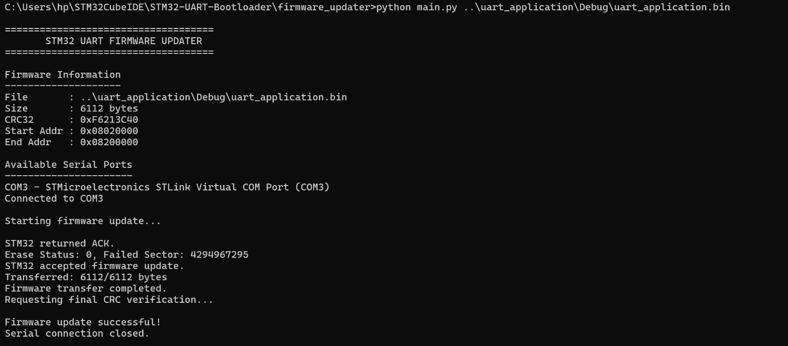
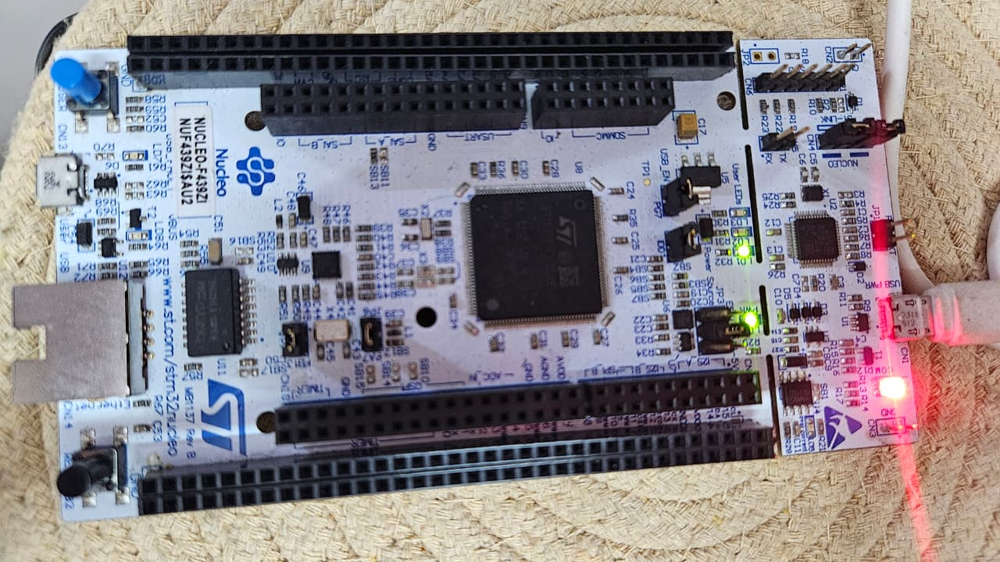
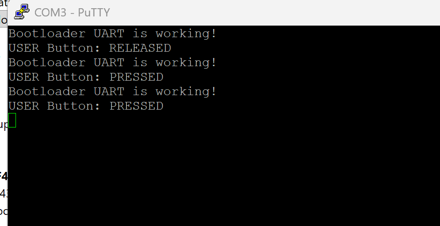
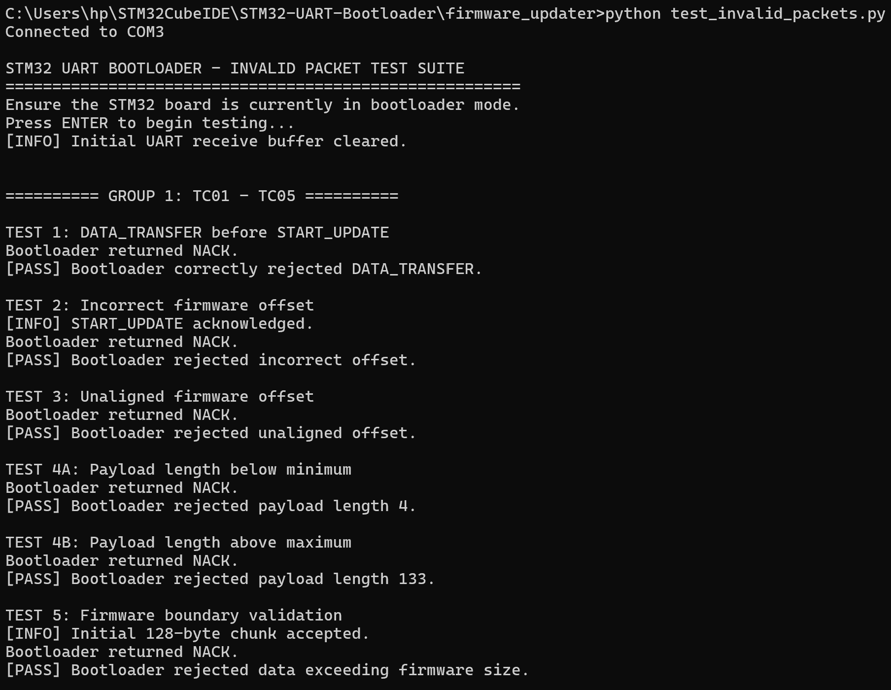
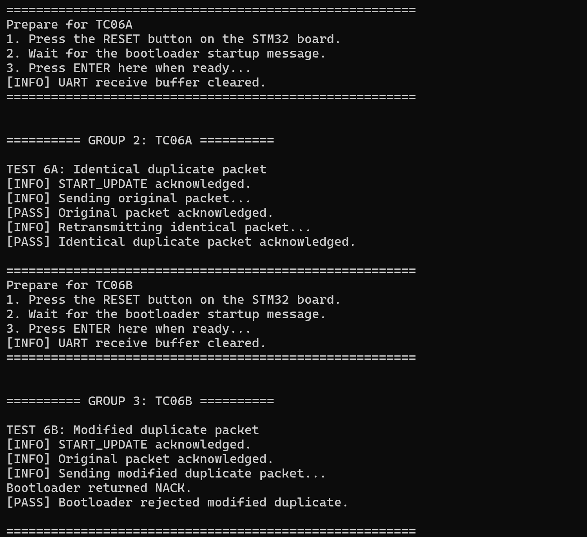
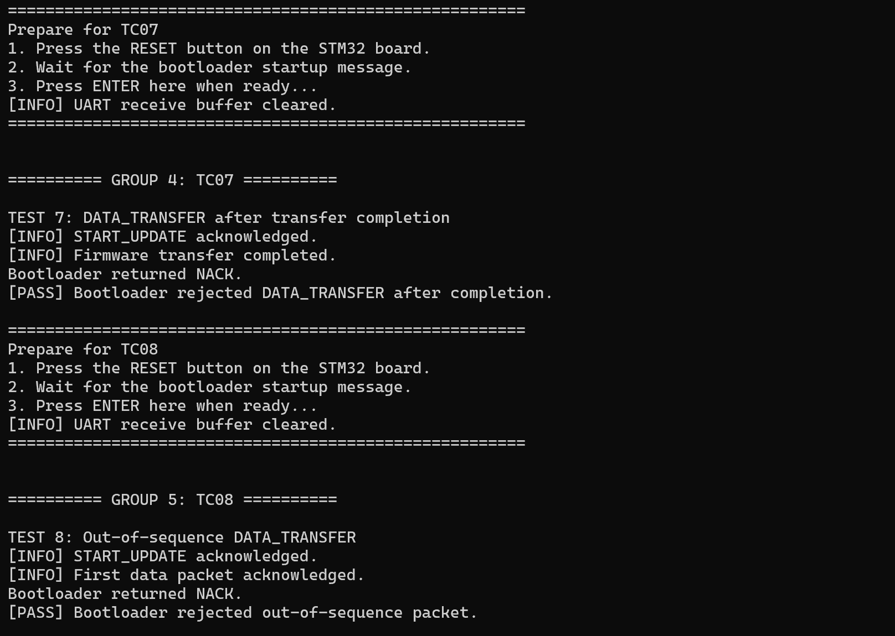
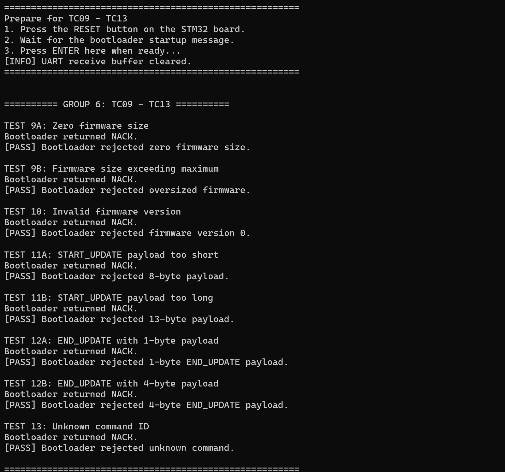
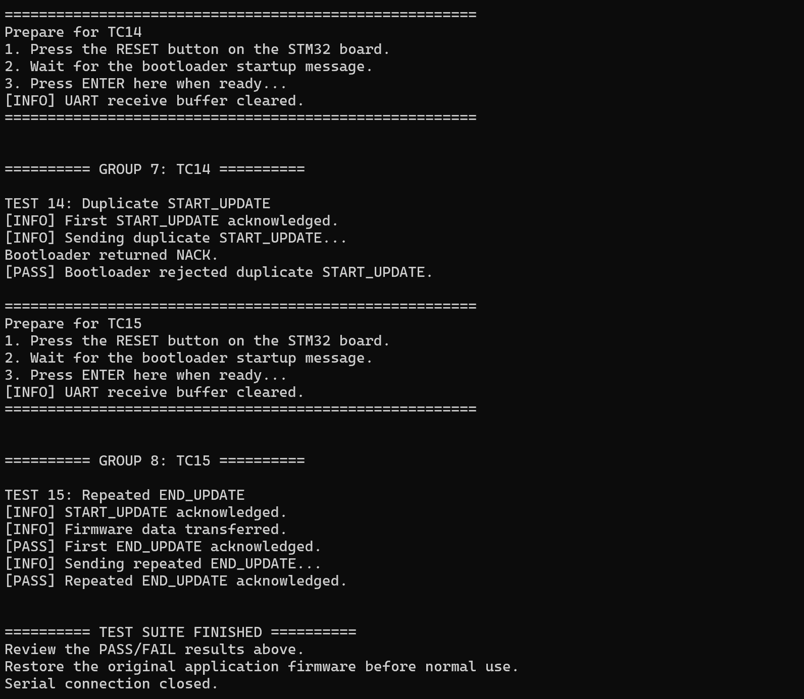
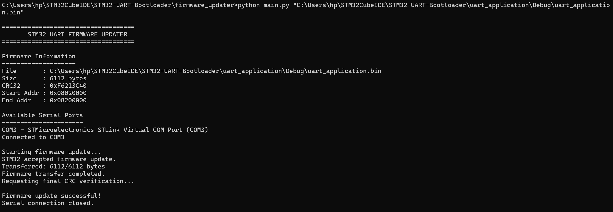

# STM32 UART Bootloader & Firmware Updater

A custom UART-based bootloader for the **STM32F439ZI**, featuring firmware reception, Flash programming, CRC32 integrity verification, application metadata management, application validation, and automatic application booting.

The project includes a Python-based firmware updater with packet handling, firmware version management, duplicate packet detection, and interrupted-update recovery.

## Project Structure

```text
STM32-UART-Bootloader/
│
├── uartbootloader/
│   ├── Core/
│   ├── Drivers/
│   └── ...
│
├── uart_application/
│   ├── Core/
│   ├── Drivers/
│   └── ...
│
├── firmware_updater/
│   ├── main.py
│   ├── protocol.py
│   ├── serial_handler.py
│   ├── firmware_parser.py
│   ├── check_app.py
│   ├── test_bootloader.py
│   ├── test_interrupted_update.py
│   ├── test_crc_corruption.py
│   ├── test_invalid_packets.py
│   └── requirements.txt
│
├── images/
│   ├── firmware_update_success.jpeg
│   ├── firmware_restoration.png
│   ├── application_running.jpeg
│   ├── bootloader_uart.png
│   ├── test_cases_01_05.png
│   ├── test_cases_06A_06B.png
│   ├── test_cases_07_08.png
│   ├── test_cases_09_13.png
│   └── test_cases_14_15.png
│
├── .gitignore
└── README.md
```

## Hardware & Development Environment

| Component | Specification |
|---|---|
| Microcontroller | STM32F439ZI |
| Development Board | NUCLEO-F439ZI |
| Architecture | ARM Cortex-M4 |
| IDE | STM32CubeIDE |
| Firmware Language | Embedded C |
| Host-side Updater | Python |
| Communication Interface | USART3 |
| UART TX / RX | PD8 / PD9 |
| Baud Rate | 115200 |
| Serial Interface | ST-LINK Virtual COM Port |

## Flash Memory Layout

| Region | Start Address | Size | Sectors |
|---|---|---|---|
| Bootloader | 0x08000000 | 64 KB | 0–3 |
| Metadata | 0x08010000 | 64 KB | 4 |
| Application | 0x08020000 | 1920 KB | 5–23 |

The bootloader and metadata regions are preserved during application firmware updates. Only application Flash sectors are erased and programmed.

## Implemented Features

### 1. Bootloader Architecture

- Separate bootloader and application projects.
- Independent linker scripts and dedicated Flash memory partitioning.
- Application vector table relocation.
- Manual bootloader entry using the onboard B1 USER button.
- Automatic application boot when a valid application is available.
- Protected bootloader Flash region during firmware updates.

### 2. Application Validation & Handover

- Initial Stack Pointer validation against SRAM boundaries.
- Reset Handler address and application Flash range validation.
- Application metadata and CRC32 validation.
- Interrupt and SysTick cleanup before application handover.
- Assembly-based application jump.
- Vector Table Offset Register (VTOR) relocation.

### 3. UART Firmware Update Protocol

Communication between the Python updater and STM32 bootloader uses a custom packet-based UART protocol.

**Packet format:**

```text
[START_BYTE] [COMMAND_ID] [PAYLOAD_LENGTH] [PAYLOAD]
```

| Parameter | Value |
|---|---|
| Start Byte | 0xAA |
| ACK | 0x79 |
| NACK | 0x1F |
| Maximum Payload | 255 bytes |
| Firmware Chunk Size | 128 bytes |

**Supported commands:**

| Command | Command ID | Description |
|---|---|---|
| GET_VERSION | 0x01 | Retrieve bootloader version |
| GET_STATUS | 0x02 | Retrieve bootloader status |
| GET_APP_INFO | 0x03 | Retrieve application information and validity |
| START_UPDATE | 0x04 | Initiate firmware update |
| DATA_TRANSFER | 0x05 | Transfer firmware data |
| END_UPDATE | 0x06 | Complete firmware update and verify CRC |

### 4. Flash Programming & Metadata Management

- Application Flash sector erasure and programming using STM32 HAL Flash APIs.
- Sequential firmware chunk reception.
- Firmware offset and boundary validation.
- Application metadata stored in a dedicated Flash sector.
- Metadata invalidation before firmware updates.
- Valid marker programmed only after successful CRC verification.
- Bootloader and metadata regions protected during application erasure.

### 5. Firmware Integrity Verification

- CRC32 calculation on both Python and STM32 sides.
- Comparison of expected and calculated firmware CRC.
- Application validation using stored metadata.
- Firmware size and application memory boundary checks.
- Hardware fault-injection testing using an intentionally modified firmware byte.
- Verification that corrupted firmware is rejected when CRC values do not match.

### 6. Python Firmware Updater

- Firmware binary loading and size validation.
- CRC32 calculation and serial port detection.
- UART communication using PySerial.
- Packet construction and transmission.
- ACK/NACK response handling.
- Firmware transfer progress monitoring and final verification.

### 7. Firmware Transfer Reliability

- Duplicate DATA packet detection using offset, length, and Flash data comparison.
- Re-acknowledgement of previously accepted identical packets.
- Prevention of repeated Flash programming for duplicate packets.
- Packet offset and payload boundary validation.
- Tracking of the last successfully accepted firmware packet.
- Repeated END_UPDATE request handling after successful completion.
- ACK timeout handling and retransmission support in the Python updater.

### 8. Firmware Version Management

- Firmware version supplied by the Python updater during START_UPDATE.
- 32-bit packed version representation using major, minor, and patch numbers.
- Firmware version and metadata format version stored in Flash metadata.
- Firmware version retrieved through GET_APP_INFO.
- Legacy metadata recognized and reported as an unknown legacy version.
- Firmware metadata committed only after successful CRC verification.

### 9. Interrupted Firmware Update Recovery

- Application metadata invalidated before starting an update.
- Incomplete firmware is prevented from being treated as a valid application.
- Bootloader remains operational when application validation fails.
- A fresh firmware update can be initiated after an interrupted update.
- Application execution restored through successful firmware reprogramming and metadata validation.

### 10. Invalid Packet & Command Handling

The bootloader validates incoming commands and firmware transfer packets before processing them.

Implemented checks include:

- DATA_TRANSFER rejection before START_UPDATE.
- Incorrect and unaligned firmware offset rejection.
- Invalid DATA_TRANSFER payload length rejection.
- Firmware boundary validation.
- Rejection of data received after firmware transfer completion.
- Out-of-sequence packet rejection.
- Zero and oversized firmware rejection.
- Invalid firmware version rejection.
- Invalid START_UPDATE and END_UPDATE payload length rejection.
- Unknown command ID rejection through a default NACK response.
- Duplicate START_UPDATE rejection.
- Repeated END_UPDATE handling after successful firmware installation.

### 11. CRC Corruption Detection & Recovery

A controlled fault-injection test was performed by modifying one byte of the firmware data before transmission while retaining the CRC calculated from the original firmware.

- The updater sends the original firmware size, CRC32, and version in START_UPDATE.
- One byte in the transmitted firmware copy is intentionally modified.
- The STM32 calculates CRC32 from application Flash when END_UPDATE is received.
- The CRC mismatch causes the bootloader to reject END_UPDATE with NACK.
- Since metadata was invalidated at the start of the update, corrupted firmware remains invalid.
- After reset, the bootloader stays active instead of jumping to the invalid application.
- The original firmware was subsequently transferred successfully and application execution was restored.

A separate `test_crc_corruption.py` script was added to reproduce the test without modifying the normal `main.py` updater. The script passed its Python syntax check; the hardware fault-injection results documented below were obtained during manual testing.

## Firmware Update Workflow

```text
       Python Firmware Updater
                 |
                 v
          Load Firmware BIN
                 |
                 v
           Calculate CRC32
                 |
                 v
          Connect via UART
                 |
                 v
            START_UPDATE
                 |
                 v
        Receive Firmware Version
                 |
                 v
        Validate Firmware Size
                 |
                 v
        Invalidate Metadata
                 |
                 v
        Erase Application Flash
                 |
                 v
           DATA_TRANSFER
                 |
                 v
        Validate Packet Offset
                 |
                 v
        Check Duplicate Packet
                 |
                 v
        Program Application Flash
                 |
                 v
            Send ACK / NACK
                 |
                 v
             END_UPDATE
                 |
                 v
            Verify CRC32
                 |
                 v
            Write Metadata
                 |
                 v
         Validate Application
                 |
                 v
        Boot Application Firmware
```

## Hardware Validation & Testing

Hardware testing was performed using the Python firmware updater and STM32F439ZI NUCLEO development board.

### Test Configuration

| Parameter | Result |
|---|---|
| Firmware File | uart_application.bin |
| Firmware Size | 6,112 bytes |
| CRC32 | 0xF6213C40 |
| UART Port | COM3 |
| Baud Rate | 115200 |
| Transfer Chunk Size | 128 bytes |
| Flash Erase | Successful |
| Firmware Transfer | Successful |
| CRC Verification | Successful |
| Metadata Programming | Successful |
| Automatic Application Boot | Successful |

### 1. Successful Firmware Update

The Python firmware updater successfully transmitted the application binary to the STM32 bootloader. Firmware integrity was verified using CRC32 before application metadata was committed.



### 2. Application Execution

After firmware programming and verification, the STM32 successfully booted the application. LD1 was observed blinking at approximately one-second intervals.



### 3. Bootloader UART Communication

UART communication was verified through the ST-LINK Virtual COM Port using PuTTY.



## Invalid Packet & Reliability Test Results

A total of **15 test cases** were executed against the STM32 bootloader using the Python test suite.

**All 15 test cases successfully passed on hardware.**

| Test Case | Validation | Result |
|---|---|---|
| TC01 | DATA_TRANSFER before START_UPDATE | PASS |
| TC02 | Incorrect firmware offset | PASS |
| TC03 | Unaligned firmware offset | PASS |
| TC04 | Invalid DATA_TRANSFER payload lengths (4 and 133 bytes) | PASS |
| TC05 | Firmware boundary validation | PASS |
| TC06A | Identical duplicate packet acceptance | PASS |
| TC06B | Modified duplicate packet rejection | PASS |
| TC07 | DATA_TRANSFER after transfer completion | PASS |
| TC08 | Out-of-sequence DATA_TRANSFER packet rejection | PASS |
| TC09 | Invalid firmware sizes (zero and oversized) | PASS |
| TC10 | Invalid firmware version | PASS |
| TC11 | Invalid START_UPDATE payload lengths (8 and 13 bytes) | PASS |
| TC12 | Invalid END_UPDATE payload lengths (1 and 4 bytes) | PASS |
| TC13 | Unknown command ID rejection | PASS |
| TC14 | Duplicate START_UPDATE rejection | PASS |
| TC15 | Repeated END_UPDATE acknowledgement | PASS |

The test suite includes subtests for payload lengths and firmware sizes. All tested conditions returned the expected ACK or NACK response.

### TC01–TC05: Packet & Boundary Validation

Validated DATA_TRANSFER rejection before an update, incorrect and unaligned offsets, invalid payload lengths, and firmware boundary protection.



### TC06A–TC06B: Duplicate Packet Handling

Verified that identical duplicate packets are acknowledged without repeated Flash programming, while modified duplicate packets are rejected.



### TC07–TC08: Transfer Sequence Validation

Verified rejection of additional firmware data after transfer completion and rejection of out-of-sequence firmware packets.



### TC09–TC13: Invalid Input & Command Validation

Validated firmware size, firmware version, command payload lengths, and unknown command handling.



### TC14–TC15: Update State Validation

Verified duplicate START_UPDATE rejection and successful acknowledgement of a repeated END_UPDATE request after successful firmware installation.



## Interrupted Firmware Update Recovery Test

A controlled interruption test was performed using `test_interrupted_update.py`.

1. The updater sent START_UPDATE and received ACK.
2. The updater sent the first 128-byte DATA_TRANSFER packet and received ACK.
3. The serial connection was deliberately closed without sending END_UPDATE.
4. The board was reset without holding the B1 USER button.
5. The bootloader remained active and did not execute the incomplete application.
6. The original application firmware was transferred again successfully.
7. The application booted and LD1 resumed blinking.

The final GET_APP_INFO check reported:

```text
Application Address: 0x08020000

Application Status: VALID

Firmware Version: 1.0.2
```

This verifies that an interrupted update leaves the application invalid while keeping the bootloader available for a fresh update and recovery.

## Firmware Version Management Test

| Firmware Version | Result |
|---|---|
| 1.0.0 | Successfully installed and reported |
| 1.0.1 | Successfully installed and reported |
| 1.0.2 | Successfully installed, restored and reported |

The GET_APP_INFO command reported the stored firmware version from STM32 Flash metadata. The Python updater transmits the firmware version as part of START_UPDATE, and the bootloader stores it after successful firmware CRC verification.

## CRC Corruption & Recovery Hardware Test

A controlled corruption test was performed using the original application binary (6,112 bytes, expected CRC32 `0xF6213C40`).

1. The updater sent START_UPDATE with the original firmware size, CRC32, and version.
2. One byte at offset 100 was intentionally modified in the firmware data sent to the STM32.
3. The bootloader acknowledged the DATA_TRANSFER packets.
4. On END_UPDATE, the bootloader recalculated CRC32 from Flash and returned NACK because the calculated CRC did not match the expected CRC.
5. The board was reset normally, without holding B1. LD1 remained OFF, consistent with the bootloader refusing to jump to the invalid application.
6. The board was returned to bootloader mode and `test_bootloader.py` reported `Application Status: INVALID`.
7. The original, unmodified firmware was transferred using the normal updater. END_UPDATE was acknowledged.
8. After reset, LD1 resumed blinking. A subsequent GET_APP_INFO check reported `Application Status: VALID` and `Firmware Version: 1.0.2`.

**Observed result:** The corrupted firmware was rejected, the bootloader remained available for recovery, and the original firmware was successfully restored.

A standalone `test_crc_corruption.py` script was added for repeatable testing. Its Python syntax check passed; the hardware results above were obtained during the earlier manual fault-injection test.

## Firmware Restoration & Recovery

After completing the invalid packet, reliability, interrupted-update, and CRC corruption tests, the original application firmware was successfully restored using the normal Python firmware updater.

- Original firmware size: 6,112 bytes.
- CRC32: `0xF6213C40`.
- Firmware transfer completed successfully.
- Final CRC verification passed.
- Application metadata was successfully programmed.
- LD1 resumed blinking after a normal reset.



## Software Requirements

### STM32 Development

- STM32CubeIDE
- STM32 HAL Libraries

### Python Firmware Updater

- Python 3
- PySerial

Install the Python dependencies:

```bash
pip install -r requirements.txt
```

Run the normal firmware updater from the `firmware_updater` directory:

```bash
python main.py ..\uart_application\Debug\uart_application.bin
```

Run the invalid packet test suite:

```bash
python test_invalid_packets.py
```

Run the dedicated CRC corruption test from the same directory:

```bash
python test_crc_corruption.py ..\uart_application\Debug\uart_application.bin
```

**Note:** The CRC corruption test intentionally invalidates the current application by starting an update and sending modified firmware data. After the test, use the normal `main.py` updater with the original, unmodified firmware binary to restore the application.

Ensure the STM32 is in bootloader mode and the correct serial port is configured before initiating an update. Close PuTTY or other serial terminal applications before running a script.

## Project Status

### Phase 1 – Bootloader Architecture: COMPLETED

- Flash memory partitioning.
- Application vector table relocation.
- Application validation.
- Bootloader-to-application handover.
- Manual bootloader entry.
- Automatic application boot.
- Hardware verification.

### Phase 2 – UART Firmware Update: COMPLETED & HARDWARE TESTED

- UART communication protocol.
- Firmware reception.
- Flash erase and programming.
- Metadata management.
- CRC32 firmware integrity verification.
- Python-based firmware updater.
- Automatic application boot after successful update.

### Phase 3 – Reliability & Recovery: IMPLEMENTED & HARDWARE TESTED

**Implemented and verified:**

- Duplicate DATA packet detection.
- Duplicate packet acknowledgement without repeated Flash programming.
- Firmware offset and packet boundary validation.
- Repeated END_UPDATE request handling.
- Firmware version management and GET_APP_INFO reporting.
- Invalid firmware size and version rejection.
- Invalid command payload length rejection.
- Unknown command ID rejection.
- Duplicate START_UPDATE rejection.
- Interrupted firmware update recovery, verified on hardware.
- Recovery by reinstalling firmware after an interrupted update.
- CRC corruption rejection and recovery, verified on hardware.
- Complete 15-test invalid packet and reliability validation suite passed on hardware.

**Additional development and validation:**

- Dedicated CRC corruption test script added and Python syntax checked.
- Standalone hardware execution of the CRC corruption script remains to be repeated.

## Future Improvements

- Firmware authenticity and secure update mechanisms.
- Firmware compatibility checks.
- More comprehensive communication fault-injection testing.
- Further UART synchronization and timeout improvements.
- Communication stress testing.
- More robust packet framing and recovery mechanisms.

## Author

**Amrutha Pradeep**

Electronics and Communication Engineering  
Sardar Vallabhbhai National Institute of Technology (SVNIT), Surat